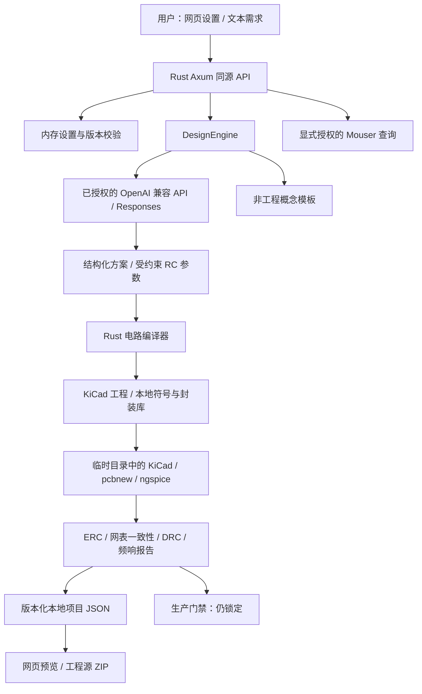

# AI-PCB 网页平台架构

文档整理：2026-11-02。描述受约束 RC 工程闭环；本轮本地检查与历史工程验收须分别阅读 `VERIFICATION.md`。

## 1. 产品边界

用户从网页配置模型与工具，通过自然语言创建和迭代项目。模型负责需求分析及参数提取，不直接写 PCB、执行任意代码或宣布工程检查通过。Rust 将受支持的电路参数编译成 KiCad 文件，调用本机工具并保存真实报告。

当前真实工程仅支持低压、低能量的无源一阶 RC 低通（0.1–5 V，R 1 kΩ–1 MΩ，C 1–1000 nF，至少 60 × 40 mm 双层板）。环境监测、浇灌、电机控制等模板只生成概念数据。工程验证、概念确认和生产放行是不同状态，不得相互替代。

## 2. 数据流

模块化单体，不引入数据库服务、任务队列或 WASM。静态前端编译进 Rust 二进制；运行时不依赖 npm/CDN。工程子进程在临时目录工作，但**不是 OS 安全沙箱**，只应执行操作者信任的本机程序。

## 3. 模块职责

| 文件 | 职责 |
| --- | --- |
| `src/main.rs` | 环境配置、回环监听、数据目录锁与服务启动 |
| `src/lib.rs` | 同源/Host 检查、输入校验、版本控制、HTTP 路由、导出门禁 |
| `src/model.rs` | 项目、历史、约束、设计、AI 分析、审核数据模型 |
| `src/settings.rs` | 模型/工具运行时配置、版本校验、连接测试和密钥清除 |
| `src/openai.rs` | Responses JSON/SSE、严格结构校验、远程授权和错误处理 |
| `src/engine.rs` | 引擎接口、概念模板与规则检查 |
| `src/circuit.rs` | RC 参数范围、KiCad 工程几何、符号、封装、固定拓扑布线和 SPICE 网表 |
| `src/eda.rs` | KiCad 配置初始化、工具执行/超时、报告解析、工件收集、生产门禁 |
| `src/sourcing.rs` | 独立 Mouser 凭据、显式授权查询、结果裁剪 |
| `src/repository.rs` | 本地 JSON、独占锁、原子保存、删除 |
| `src/export.rs`、`src/archive.rs` | 文本导出、受限工程 ZIP、路径安全 |
| `tools/kicad_bridge.py` | pcbnew 网表/焊盘检查及外部路由交换 |
| `tools/spice_bridge.py` | KiCad 自带 ngspice 动态库桥接 |
| `tools/start-local.ps1` | 本机启动和可选本项目 EDA 路径配置 |
| `web/app.js`、`web/settings.js` | 工作台、设置、授权、项目管理、报告与查询 |
| `web/board.js` | 概念 SVG 或真实 `pads.json` 几何可视化 |

## 4. 工程执行链

1. 校验 `CircuitSpec` 和板尺寸，生成 4 个器件、8 个管脚、IN/OUT/GND 三个网络的源文件。
2. 读取 KiCad 版本，在临时 `KICAD_CONFIG_HOME/<major>.0` 预建空全局符号/封装库表。项目通过自身 `sym-lib-table` / `fp-lib-table` 引用本地库；不修改用户全局库表。
3. 运行 ERC、原理图 SVG 和网表导出；使用 pcbnew 桥检查网表与 PCB 管脚网络一致性。
4. 默认执行固定 RC 拓扑双层曼哈顿布线（0.4 mm 线宽、无过孔）。若配置 Freerouting JAR，则走 DSN/SES 外部交换路径；该可选路径尚未实机验收，不是通用自动布线能力保证。
5. 检查真实管脚与连通性、生成 PCB SVG、执行 DRC。
6. 使用独立 ngspice 或 KiCad Python 加载随附动态库运行理想空载 AC 仿真，断言低频/截止/高频增益。
7. ERC、网表一致性、DRC、频响通过后，才尝试生成临时 Gerber 和钻孔。工具阶段全部通过可设置 `EngineeringRun.verified`，不等于生产放行。

ERC/DRC 必须同时满足进程成功和报告结构完整、违规数组为空；缺报告不算通过。每个子进程最多 120 秒；失败或超时记录 `blocked`，不跳过检查、不自动用模拟报告兜底。工程仍在 HTTP 请求生命周期中执行，当前没有断点续跑或持久化后台任务。

## 5. 状态与持久化

`Project` 保存需求、约束、递增版本、最近 30 次摘要历史、设计与普通确认。新生成或重跑工程产生新版本并清除旧确认；历史不是可恢复的全工程快照。

`Design.circuit` 是受约束参数；`Design.engineering` 保存真实阶段、日志、预览和源工件。没有真实几何报告时界面不得凭空画出工程铜线。旧概念项目仍可读取，但不会自动获得工程状态。

配置用 `expected_version`，项目写操作用 `expected_revision` 拒绝过期写入。远程生成还校验 `config_version`，防止用户授权后目标被并发改变。同一服务的生成、设置等操作受单个许可互斥；仓库另有进程独占锁，两个服务不能写同一数据目录。

生产相关文件内容在工件收集时被清空；单文件 API 和工程 ZIP 也拒绝/排除生产工件。`manufacturing_ready` 保持 `false`，`released_at` 保持空值，普通概念确认不能改变这两个门禁。

## 6. 设置与安全

- 远程模型配置的 `provider` 仅为 `openai`，表示 OpenAI 兼容 API，不表示一定直连官方服务。`AI_PCB_ENGINE` 仅支持 `auto`、`demo`、`openai`，模型密钥统一读取 `OPENAI_API_KEY`；`auto` 缺少密钥时使用本地模板，显式 `openai` 缺少密钥时启动失败。
- `OPENAI_BASE_URL` 默认为 `https://api.openai.com/v1`，允许自定义 HTTPS、以 `/v1` 结尾的地址。请求使用 Responses API，不支持仅有 Chat Completions 的服务；模型与参数须按目标平台配置，见 `API_COMPATIBILITY.md`。
- 图形化 API 密钥和供应商密钥仅在服务内存中；设置/健康响应脱敏，不写项目、导出或浏览器存储，重启后须重填。启动环境变量及当前目录 `.env` 是可选配置来源；应用不自动保存密钥，但手工填写 `.env` 会留下本地明文，禁止提交。
- 更换目标平台或 API 地址必须重输与新目标匹配的密钥。模型请求禁止跟随重定向，仅回环地址允许 HTTP 供本地模拟测试。
- 远程请求失败不自动重试、切换模型或降级输出格式；生成失败不覆盖旧项目。授权和配置版本绑定，保存配置不等于远程连接已验证。
- 连接测试、模型生成、供应商查询均需显式授权；健康检查和读取本地项目不请求上游。
- 工具子进程移除已知模型/供应商密钥环境变量，但不是任意外部程序的安全隔离保证。
- 页面文本转义、CSV 公式防护、ZIP 文件名校验、请求/响应和工件大小限制。
- 服务仅绑定回环地址，并有同源/Host 校验；无用户鉴权、多租户、审计和公网部署能力。
- 需求和工程以本地明文保存。`store: false` 不代表兼容服务或其上游的零保留承诺。

## 7. 接口

| 方法 | 路径 | 用途 |
| --- | --- | --- |
| GET | `/api/health`、`/api/settings` | 本地状态和脱敏配置 |
| PUT / DELETE | `/api/settings` | 修改模型配置 / 清除模型密钥 |
| POST | `/api/settings/test` | 显式授权连接测试 |
| PUT | `/api/settings/tools`、`/api/settings/supplier` | 工具路径 / 供应商密钥 |
| GET | `/api/templates`、`/api/components` | 概念模板 / 静态参考元件 |
| POST | `/api/components/search` | 实时供应商查询 |
| GET / POST | `/api/projects` | 列表 / 创建 |
| GET / DELETE | `/api/projects/{id}` | 读取 / 版本校验删除 |
| POST | `/api/projects/{id}/generate` | 需求迭代 |
| POST | `/api/projects/{id}/engineering` | 重跑受支持工程工具链 |
| POST | `/api/projects/{id}/review` | 普通确认，不生产放行 |
| GET | `/api/projects/{id}/artifacts/{index}` | 按报告索引读取非生产工件或受限 SVG 预览 |
| GET | `/api/projects/{id}/export/{format}` | BOM、JSON、报告或工程源 ZIP |

## 8. 尚未完成

真实模型与供应商账户联调、供应商料号绑定与封装机械核对、非理想源/负载模型及实测、通用电路编辑与路由、生产人工签核/发布流程、后台任务持久化。真实浏览器覆盖以 `VERIFICATION.md` 的实际验收记录为准，不把接口或模拟 DOM 测试称为视觉验收。
